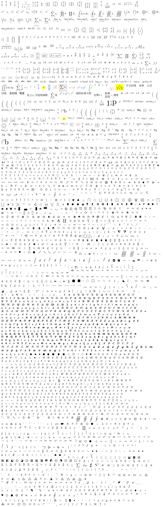

# Texon

<sub>English · [简体中文](README-zh.md)</sub>

A LaTeX math rendering library written in pure Java.

---

## Table of Contents

- [Showcase](#showcase)
- [Features](#features)
- [Directory Structure](#directory-structure)
- [Requirements](#requirements)
- [Quick Start](#quick-start)
- [Usage](#usage)
- [Configuration](#configuration)
- [Measurement](#measurement)
- [Batch and Streaming Typesetting](#batch-and-streaming-typesetting)
- [Multiple Instances and Shared Assets](#multiple-instances-and-shared-assets)
- [Pre-decoding](#pre-decoding)
- [Rendering Output](#rendering-output)
- [Glyph Asset Format](#glyph-asset-format)
- [Supported LaTeX](#supported-latex)
- [Font Assets](#font-assets)
- [FAQ](#faq)
- [License](#license)

---

## Showcase



---

## Features

- **Pure Java**: depends only on `java.*` packages; runs on desktop, server, and Android — any JVM.
- **Two rendering backends** operating on the same layout tree:
  - **Vector**: `svg(...)` → returns a self-contained SVG string (glyph paths inlined).
  - **Raster**: `png(...)` / `raster(...)` → PNG bytes / ARGB pixels.
- **Sharded assets, on-demand loading**: manifest (`.idx`) plus independent shards; hitting a character decompresses only the corresponding shard (metrics: 4096 code points per shard; outlines: 1024 code points per shard).
- **CJK dual-family coverage**: `\text{…}` serif (includes Chinese), `\mathsf{…}` / `\texttt{…}` sans-serif coverage families; automatically falls back to the default family when missing.
- **Real-time rendering friendly**: layout cache + cross-frame glyph path cache + glyph coverage cache + reusable raster sinks — well suited to live editing feedback and continuous rendering.
- **Deterministic builds**: same source + same font inputs produce byte-identical assets.

---

## Directory Structure

```
Texon/
├── assets/
│   └── fonts/
│       ├── metrics.idx                     Primary font metrics manifest
│       ├── metrics/<bucket>.bin            Primary font metrics shards (symbols / spacing / accents / family tables)
│       ├── outlines.idx                    Primary font outlines manifest
│       ├── outlines/<bucket>.bin           Primary font glyph outline shards (includes serif CJK)
│       ├── cjk-sans-metrics.idx            Sans-serif CJK family metrics manifest
│       ├── cjk-sans-metrics/<bucket>.bin   Sans-serif CJK family metrics shards
│       ├── cjk-sans-outlines.idx           Sans-serif CJK family outlines manifest
│       └── cjk-sans-outlines/<bucket>.bin  Sans-serif CJK family outline shards
└── java/
    └── texon/latex/engine/
        ├── core/                           Engine: parsing / typesetting / rendering
        │   ├── Texon.java                  Facade: load / svg / raster / png
        │   ├── TexonAssets.java            Shareable outline assets (reused across instances)
        │   ├── LayoutMetrics.java          Measurement result: width / height / baseline / left ink
        │   ├── Assets.java                 Asset interface (InputStream open)
        │   ├── FontMetrics.java            Metrics parsing (manifest + shards)
        │   ├── GlyphOutlines.java          Outline parsing (manifest + shards)
        │   ├── Parts.java                  Shard table and direct lookup
        │   ├── Tables.java                 Table segment loading (written into config)
        │   ├── TexonContext.java           Runtime context: lookup indices + configuration API
        │   ├── lex/
        │   │   └── Lexer.java              Lexing
        │   ├── parse/
        │   │   ├── Ast.java                Abstract syntax tree
        │   │   └── Parser.java             LaTeX subset grammar (recursive descent)
        │   ├── box/
        │   │   └── Box.java + subclasses   Layout intermediate representation
        │   ├── layout/
        │   │   ├── Layout.java             Typesetting
        │   │   └── LayoutCache.java        Layout cache
        │   └── render/
        │       ├── Renderer.java           Layout tree traversal
        │       ├── VectorSink.java         Vector drawing interface
        │       ├── SvgRenderer.java        SVG backend
        │       ├── SvgPath.java            SVG path parsing
        │       ├── RasterSink.java         Raster backend
        │       ├── GlyphMask.java          Glyph coverage mask
        │       ├── MaskCache.java          Glyph coverage cache
        │       ├── GlyphPaths.java         Glyph path cache
        │       ├── PathSink.java           Path sink interface
        │       ├── Raster.java             ARGB bitmap
        │       └── Png.java                PNG encoding
        └── config/
            ├── TexonOptions.java           Numeric values / capacities / switches
            ├── SymbolTable.java            Symbol / command table
            ├── SpacingTable.java           Math classes + spacing
            ├── AccentTable.java            Accent table
            ├── AccentCompat.java           Accent compatibility spacing
            ├── FamilyTable.java            Font family mapping
            ├── DelimTable.java             Delimiter stretching table
            └── ColorTable.java             Color table
```

`java/` is the source root: packages are split into `texon.latex.engine.core.*` (engine) and `texon.latex.engine.config.*` (configuration). `assets/` holds prebuilt runtime data, already included in the repository.

---

## Requirements

- JDK 8+ (official target `javac --release 11`; also compiles and runs on JDK 8)

---

## Quick Start

```bash
git clone <your>/Texon.git
cd Texon

# Compile the library
mkdir -p out && javac -encoding utf-8 -d out $(find java -name '*.java')

# Write an entry point (see below)
cat > Demo.java <<'EOF'
import java.io.File;
import texon.latex.engine.core.Assets;
import texon.latex.engine.core.Texon;
public class Demo {
	public static void main(String[] a) {
		Texon t = Texon.load(Assets.dir(new File("assets/fonts")), "metrics", "outlines");
		System.out.println(t.svg("\\frac{a}{b}", 48f).substring(0, 60) + "...");
	}
}
EOF
javac -encoding utf-8 -cp out -d out Demo.java
java -cp out Demo
```

The runtime requires `assets/fonts/` to exist in the repository (**already included**).

---

## Usage

### Loading

```java
import java.io.File;
import texon.latex.engine.core.Assets;
import texon.latex.engine.core.Texon;

// Option 1: load from a directory (recommended)
Texon texon = Texon.load(Assets.dir(new File("assets/fonts")), "metrics", "outlines");

// Option 2: any two InputStreams (manifest entries)
Texon texon = Texon.load(metricsStream, outlinesStream);
```

`Assets` is an interface with a single method `InputStream open(String name)`. The library ships with `Assets.dir(File)` (filesystem-based); you can also implement it yourself to bridge custom storage.

### Rendering

```java
// Vector: returns an SVG string
String svg = texon.svg("\\int_0^1 x\\,dx = \\frac{1}{2}", 48f);

// Raster pixels
Raster r = texon.raster("\\begin{pmatrix} a & b \\\\ c & d \\end{pmatrix}", 48f, 0xFFFFFFFF);
int width = r.width, height = r.height;
int[] pixels = r.pixels;                       // ARGB8888

// PNG bytes
byte[] png = texon.png("E = mc^2", 96f);

// Real-time: reuse the previous frame's sink
Raster frame = texon.render(source, pxPerEm, background);
```

---

## Configuration

All output-side and capacity-side parameters are centralized in `config/TexonOptions`:

```java
TexonOptions opts = new TexonOptions();
opts.pngLevel = 6;               // PNG compression level
opts.rasterSupersample = 2;      // Raster supersampling factor
opts.svgPrecision = 3;          // SVG coordinate decimal places
opts.layoutCacheCapacity = 512;  // Upper bound for layout cache entries
Texon texon = Texon.load(Assets.dir(new File("assets/fonts")), "metrics", "outlines", opts);
```

| Field | Default | Meaning |
|---|---|---|
| `braceAboveGap` / `braceBelowGap` | `35` / `35` | Vertical gap between the `\overbrace` / `\underbrace` rule and its content |
| `stackAboveGap` | `193` | Baseline gap for stacked constructions such as `\atop` |
| `alignRowGap` | `753` | Line spacing for multi-line environments such as `align` / `gather` |
| `boxPad` | `300` | Padding between the `\boxed` / `\fbox` border and its content |
| `muDiv` | `18` | 1 mu = `unitsPerEm / muDiv` |
| `delimiterPad` | `100` | Extra spacing between a delimiter and its content |
| `accentGap` | `0` | Extra baseline spacing for accent glyphs |
| `errorColor` | `0xFFFF3B30` | ARGB color of the error placeholder |
| `layoutCacheCapacity` | `256` | Upper bound for layout cache entries |
| `glyphPathsCapacity` | `4096` | Upper bound for glyph path cache entries |
| `maskCacheCapacity` | `4096` | Upper bound for glyph coverage cache entries |
| `blobBudget` | `8L << 20` | Memory budget (bytes) allowed for decompressed outline shards to remain resident |
| `pngLevel` | `6` | PNG compression level; see `java.util.zip.Deflater` |
| `svgPrecision` | `3` | SVG coordinate decimal precision (`0` = integers only) |
| `svgIdPrefix` | `"g"` | ID prefix for SVG glyph paths (avoids collisions when multiple SVGs are inlined) |
| `rasterSupersample` | `2` | Supersampling factor per pixel (larger = smoother but slower) |
| `pngFilter` | `PNG_FILTER_NONE` | PNG row filter: `PNG_FILTER_NONE` / `0..4` (fixed) / `PNG_FILTER_AUTO` (per-row adaptive) |
| `pngColorMode` | `PNG_COLOR_RGB` | PNG color mode: `PNG_COLOR_RGB` / `PNG_COLOR_AUTO` (converts to grayscale when all pixels are gray) |

**PNG row filtering**: for formula-type content, **no filtering is optimal**, hence the default `PNG_FILTER_NONE`. `PNG_FILTER_AUTO` is provided as an option for photo-type content.

**On grayscale**: enabled only when every pixel satisfies `r == g == b`. Measured savings are 12%–15%, but some decoders interpret linear grayscale differently, which can alter the visual appearance.

---

## Measurement

`measure(...)` returns `LayoutMetrics`, in **pixels** throughout:

```java
LayoutMetrics m = texon.measure("\\frac{a+b}{c}", 48f);
m.width;      // Total width (includes right-side italic correction)
m.height;     // Total height (ascender + descender)
m.baseline;  // Distance from the top to the baseline
m.inkLeft;    // Left ink (may be negative; used for stroking / cropping alignment)
```

Raster results likewise carry the baseline and ink bounding box, enabling inline alignment and compact export:

```java
Raster r = texon.raster("\\sum_{i=1}^{n} a_i", 48f);
r.baseline;                        // Baseline position in pixel coordinates
r.inkX; r.inkY; r.inkW; r.inkH;    // Bounding box of non-background pixels (inkW = inkH = 0 for an empty formula)
```

---

## Batch and Streaming Typesetting

Combine multiple formulas into a line or a paragraph, then render in one pass.

```java
// Baseline-aligned horizontal layout (uses atom spacing by default)
Box line = texon.row(new String[]{"a+b", "=", "c"});

// Specified kerning (font units, same scale as unitsPerEm)
Box line2 = texon.row(new String[]{"x", "y"}, 200);

// Line-by-line baseline alignment + line gap; align takes VBox.LEFT / VBox.CENTER
Box block = texon.block(new String[]{"\\frac{a}{b}", "= c"}, 400, VBox.LEFT);

// Render the whole block
Raster px = texon.raster(block, 48f);                 // White background
Raster tr = texon.raster(block, 48f, 0x00000000);     // Transparent background
byte[] png = Png.encode(px, 6, TexonOptions.PNG_FILTER_NONE, TexonOptions.PNG_COLOR_RGB);

// Or draw directly to any VectorSink (SVG backend / custom backend)
texon.draw(block, 0xFF000000, sink);
```

`row` uses `HBox.of` / `HBox.kerned`; `block` uses `VBox.of` and iteratively computes line positions via `off[i] = off[i-1] - (depth[i-1] + lineGap + height[i])`.

---

## Multiple Instances and Shared Assets

The outline layer (`GlyphOutlines`) can be shared across instances; the metrics layer and configuration are bound to `TexonContext` and are **not shared**:

```java
TexonAssets shared = TexonAssets.load(Assets.dir(new File("assets/fonts")), "outlines", 8L << 20);

TexonOptions a = new TexonOptions();
TexonOptions b = new TexonOptions();
b.errorColor = 0xFF0000FF;

Texon t1 = shared.newTexon(Assets.dir(new File("assets/fonts")), "metrics", a);
Texon t2 = shared.newTexon(Assets.dir(new File("assets/fonts")), "metrics", b);
// t1.outlines() == t2.outlines(), but t1.context() != t2.context()
```

- Sharing `GlyphOutlines` means the two instances decompress the outlines only once; each instance still holds its own `blobBudget` and configuration.
- ⚠️ `FontMetrics` **cannot be shared**: symbol / spacing / accent / family tables are written into `TexonContext` via `Tables.install` at load time; sharing across instances would corrupt the configuration.
- `Texon.load(...)` semantics are unchanged (each builds its own outlines); sharing is **opt-in**.
- `TexonAssets.addFamily(...)` can append a family to the shared outlines (e.g., a sans-serif CJK coverage family).

---

## Pre-decoding

For live editing feedback, you can parse and decode a formula in advance to avoid first-frame jank:

```java
texon.prefetch("\\int_0^1 \\frac{x^2}{1+x}\\,dx");
texon.prefetchAsync(source, executor);   // async variant
```

Implementation reuses `Renderer.walk` plus a **no-op sink**: inside `glyph(cp, …, family, …)`, only `metrics.width(cp, family)` and `outlines.path(cp, family)` are called to trigger shard decoding.

---

## Rendering Output

| Method | Returns | Description |
|---|---|---|
| `String svg(latex, pxPerEm)` | `String` | Self-contained `<svg>` text with glyph paths inlined |
| `Raster raster(latex, pxPerEm, bg)` | `Raster` | `{width, height, int[] pixels}`, ARGB8888 |
| `byte[] png(latex, pxPerEm[, bg])` | `byte[]` | PNG-encoded bytes |
| `Raster render(latex, pxPerEm, bg)` | `Raster` | Reuses the previous frame's sink (real-time) |
| `LayoutMetrics measure(latex, pxPerEm)` | `LayoutMetrics` | Size / baseline / ink; see [Measurement](#measurement) |
| `Box box(latex)` | `Box` | Parses + typesets, yielding the layout tree |
| `Box row(String[] parts[, gap])` | `Box` | Baseline-aligned horizontal layout; see [Batch and Streaming Typesetting](#batch-and-streaming-typesetting) |
| `Box block(String[] lines, lineGap[, align])` | `Box` | Multi-line baseline alignment + line gap |
| `Raster raster(Box root, pxPerEm[, bg])` | `Raster` | Renders any layout tree |
| `void draw(Box root, argb, sink)` | — | Draws to any `VectorSink` |
| `void prefetch(latex)` / `prefetchAsync(latex, executor)` | — | Pre-parses and decodes the required shards; see [Pre-decoding](#pre-decoding) |

---

## Glyph Asset Format

Binary, **big-endian**. Every shard is a fully self-contained, independently parseable unit; the manifest only records the shard table.

### Manifest `TXID`

```
magic "TXID" | version i32 | bits i32 | total i32 | parts i32
per part: base i32 | count i32 | flags i32 | nameLen i16 | name ascii
flags bit0 = CORE (carries constants / variant chains / assemblies / table segments; must remain resident)
```

### Metrics Shard `TXM2`

```
"TXM2" | rawLen i32 | zlib(body)
body = "TXM1" | unitsPerEm i32 | asc i32 | desc i32 | lineGap i32
       | constCount i32 | consts[]{ keyLen i16, key, value i32 }
       | glyphCount i32 | cp[] i32 | w[] i32 | h/d/ic/il/ta/it/ib[] i16
       | chains[] | hchains[] | asms[]          (CORE shards only)
       | tablesLen i32 | tables[]                (CORE shards only, TXTB table segments)
```

### Outline Shard `TXO1`

```
"TXO1" | rawLen i32 | zlib(payload)
payload = n i32 | cp[n] i32 | off[n+1] i32 | data[] (concatenated UTF-8 SVG path strings)
```

Bucketing: metrics use `cp >> 12` (4096 code points per shard); outlines use `cp >> 10` (1024 code points per shard).

---

## Supported LaTeX

The recursive-descent parser covers most of the LaTeX math subset (**not** full TeX). Coverage includes:

- **Subscripts / superscripts / fractions / radicals**: `_ ^`, `\frac \dfrac \tfrac \cfrac`, `\sqrt \sqrt[3]`
- **Large operators and limits**: `\sum \prod \int \oint \lim \liminf \argmax \projlim`
- **Auto-sizing delimiters**: `\left( \right]`, `\bigl \Bigl \biggl` …
- **Matrices / environments**: `pmatrix bmatrix matrix array cases align gather`, `\hline \multicolumn`, `\substack \sideset \smashoperator`
- **Accents and decorations**: `\hat \tilde \bar \vec \dot \utilde \overgroup \underbar \overbrace \underbrace`
- **Boxes / colors**: `\boxed \cancel \cancelto \textcolor \colorbox`
- **Text and font families**: `\text \textrm \textsf \texttt`, `\mathbf \mathcal \mathfrak \mathsf \mathtt \mathbb`
- **Arrows / relations / symbols**: `\xrightarrow \xLeftrightarrow \xmapsto`, `\coloneqq \subseteqq \nexists \nleq …`
- **Chinese / CJK**: `\text{中文}` serif, `\mathsf{한글}` sans-serif

---

## Font Assets

`assets/fonts/` is already included in the repository:

```java
Texon texon = Texon.load(Assets.dir(new File("assets/fonts")), "metrics", "outlines");
```

The assets are derived data extracted offline from upstream open-source fonts. Sources and licenses are listed in [`assets/NOTICE.md`](assets/NOTICE.md).

---

## FAQ

**Q: The runtime reports that `metrics.idx` / `outlines.idx` cannot be found?**
`assets/fonts/` is missing or the path is wrong. Make sure the repository contains `assets/fonts/` (shipped with the library), or point `Assets.dir(new File("correct/path/fonts"))` at the right location.

**Q: A character renders blank / as a missing glyph?**
First confirm that the corresponding glyph exists in the assets. `assets/fonts/` is prebuilt data; coverage is documented in [`assets/NOTICE.md`](assets/NOTICE.md).

---

## License

- **Code (`java/`)**: **MIT License**; see [`LICENSE`](LICENSE) in the root directory.
- **Assets (`assets/fonts/`)**: **derived data** from upstream open-source fonts; comply with each source's license, see [`assets/NOTICE.md`](assets/NOTICE.md).
